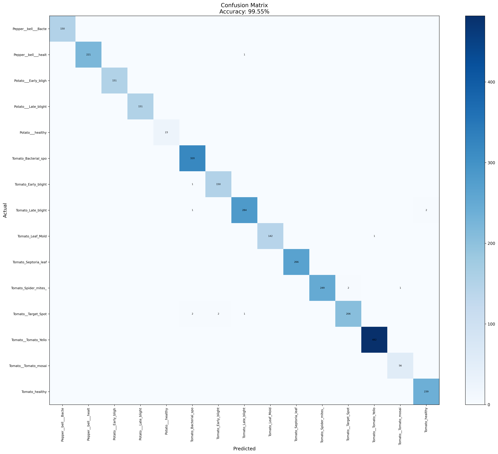
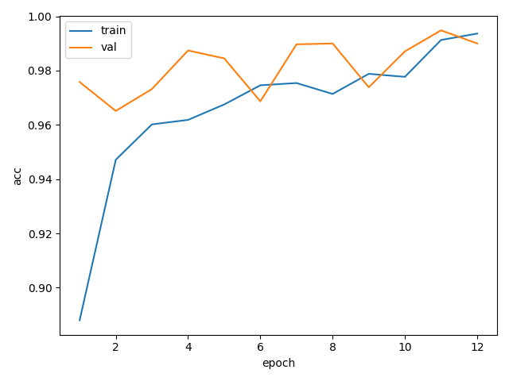
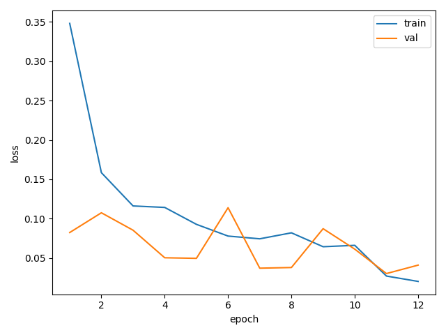
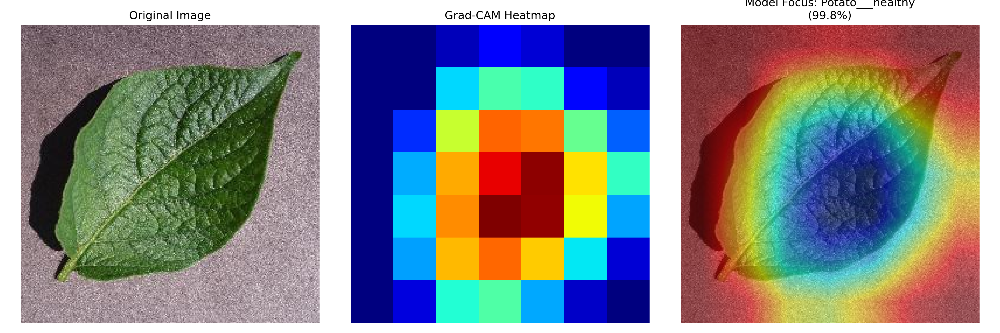

# Plant Disease Detection with MobileNetV2 and Explainable AI

A PyTorch research project for **15-category leaf-image classification** across pepper, potato and tomato. The main classifier uses MobileNetV2; the repository also documents Grad-CAM examples and a model-size / inference-speed benchmark.

**Scope:** This repository preserves the supplied experiment's original code and reported artifacts, with the **original reported test accuracy** as the main result. It is a research prototype, not a validated field-diagnosis system.

## Original test results

**MobileNetV2 reported test accuracy: 99.5490% (99.55% rounded)** on **3,104 images** across **15 classes**.

| Metric | Original reported result |
|---|---:|
| Test accuracy | **99.5490%** |
| Weighted precision | 99.5510% |
| Weighted recall | 99.5490% |
| Weighted F1-score | 99.5485% |
| Evaluated images | 3,104 |

These figures come from the saved `results/evaluation_metrics.txt`. They describe the original local test evaluation, not an externally validated field-performance benchmark.

### Original confusion matrix



### Data-integrity note

An independent read-only exact-hash audit found **7 duplicate groups crossing train, validation and test folders**, including **4 affected test images**. Follow-up verification artifacts are retained under `verification_results/` for transparency, but the main results above intentionally report the **original experiment only**. Neither near-duplicate nor same-leaf leakage has been fully ruled out, so this test result should not be described as fully leakage-free.

### Original training curves





## Dataset and protocol

The existing local dataset is a **15-class subset of PlantVillage** (Pepper 2, Potato 3, Tomato 10 classes) with the following observed folder counts:

| Split | Images |
|---|---:|
| Train | 14,437 |
| Validation | 3,097 |
| Test | 3,104 |
| **Total** | **20,638** |

This is approximately **70/15/15**, not the 80/10/10 mentioned in an earlier proposal. The original `scripts/split_data.py` uses per-class random splits with seed 42, and **does not deduplicate source images before splitting**. The reported test split should not be described as fully leakage-free. We do not bundle the source images or claim a verified exact downloadable dataset version. Reproduction requires supplying an appropriately licensed copy of the matching 15-class dataset in `data/train/`, `data/val/`, `data/test/`.

## Model and implementation

- MobileNetV2 checkpoint reported as **8.77 MB** on disk (`results/model_info.txt`). This is file size, not runtime RAM usage.
- Original pipeline resizes images to **224 × 224**, uses ImageNet normalization, with training augmentations including horizontal flip, rotation and color jitter.
- The original training script records a learning rate of **3e-4**, Adam optimizer, batch size 32 and ReduceLROnPlateau scheduler; `results/logs.csv` contains 12 logged epochs. The script's **default** `--pretrained` value is **0**; therefore the historical claim that the reported checkpoint was trained with ImageNet pretraining cannot be established from the supplied files alone.
- Reported historical CPU **forward-pass** timing: **18.59 ms average, 1.87 ms standard deviation** across 100 timed runs after 10 warm-ups, using a synthetic batch of size 1. This does not include image loading, preprocessing or full device deployment latency. The CPU model/hardware was not recorded.

## Grad-CAM visualization

The original project includes Grad-CAM code under `scripts/` and saved heatmaps. These are **model-attribution visualizations, not proof that the model identified the true biological cause of a disease**.



The legacy `scripts/test_gradcam.py` and `scripts/gradcam.py` are preserved for reference. Their model-loading code expects a raw state dictionary, while the saved checkpoint is a dictionary containing `state_dict`, `classes`, and metadata. They may need adaptation to load the checkpoint correctly; the historical sample image does not independently validate that script end to end.

## Comparison with other architectures (historical)

| Model | Reported accuracy (%) | Model size (MB) | Inference time (ms) |
|---|---:|---:|---:|
| MobileNetV2 | 99.55 | 8.77 | 18.59 |
| EfficientNet-B0 | 99.64 | 15.64 | 24.76 |
| ResNet50 | 99.19 | 90.09 | 46.46 |

**Not an apples-to-apples test-set benchmark.** The supplied `train_resnet_efficientnet.py` reports **best validation accuracy** for EfficientNet-B0 and ResNet50, whereas the MobileNetV2 accuracy is a pre-entered value in that script, not recomputed in the same comparison run. The code also uses differing training procedures. Treat this table as *historical reported figures*, not evidence of equal-condition test performance. It does suggest a reported size/latency tradeoff, subject to the timing caveats above.

## Repository structure

```text
models/                  Model definitions
scripts/                 Original dataset, Grad-CAM and utility scripts
results/                 Original aggregate metrics, confusion matrix, training plots and two Grad-CAM examples
verification_results/    Supplementary duplicate audit and verification files (not headline metrics)
train.py                 Original MobileNetV2 / CNN trainer
eval.py                  Original (unfiltered) evaluation code
train_resnet_efficientnet.py  Original comparison experiment code
main_visual.py           Original single-image prediction visualization
model_info.py            Original size and latency benchmark
requirements.txt         UTF-8 copy of the supplied environment package list
.gitignore
```

## Usage and reproducibility

1. Use a compatible Python environment and install dependencies with `pip install -r requirements.txt`. The supplied pinned environment was not freshly installed/tested during packaging.
2. Obtain your own authorized dataset and place it under `data/` with `train`, `val`, `test` class subfolders. Keep it private/local. **Do not rerun `scripts/split_data.py` on the original folders without backing them up**; it copies images into `data/` and can change split contents.
3. The repository does **not** include any `.pth` weights. To run saved-checkpoint evaluation or prediction, place your trusted local `best_9948.pth` under `weights/` and use your original `weights/classes.json` for workflows that require it. **Do not run model checkpoint files from unknown sources:** PyTorch checkpoint deserialization can be unsafe.
4. You can check archived supplementary verification artifacts *without model weights or images*:

   ```bash
   python verification_results/verify_saved_results.py
   ```

5. To reproduce the supplementary exact-duplicate-filtered evaluation on your original Windows project, see `verification_results/evaluate_clean_test.py` and the audit CSV. Paths in that audit use Windows separators, so that historical script is **Windows-specific without adaptation**. It reads `data/test`, checkpoint and audit CSV, and writes only to `verification_results/`. Running this script again may overwrite those *verification outputs*; save a copy if needed.
6. The historical root scripts are included **as research provenance**, not guaranteed ready-to-run demos. In particular, `train.py`, `eval.py`, `model_info.py`, `main_visual.py`, and `train_resnet_efficientnet.py` write output files in the working project. Run them only in a separate working copy if you want to protect your local artifacts.

## Limitations

- PlantVillage imagery is relatively controlled; no external PlantDoc/field test has been supplied.
- Exact duplicates were audited, but visually similar or same-leaf groups were not exhaustively checked.
- The main reported result comes from one split and one saved checkpoint; deployment reliability is unknown.
- The three-model comparison mixes validation and test-derived numbers and is not a controlled held-out test comparison.
- There is no downloadable model artifact in this repository; model inference requires a locally trusted checkpoint.
- The separate source files and original checkpoint were not fully retrained or end-to-end rerun during creation of this GitHub package. Saved aggregate results and code syntax were checked.

## Data and privacy

No dataset folders, original full-resolution leaf image collections, individual prediction batches, private research files or trained model checkpoints are distributed. This repository contains only source code, aggregate evaluation results, and a small number of already-produced demonstrative leaf-image Grad-CAM visualizations. Check source-image licensing before publishing even those visual examples.
